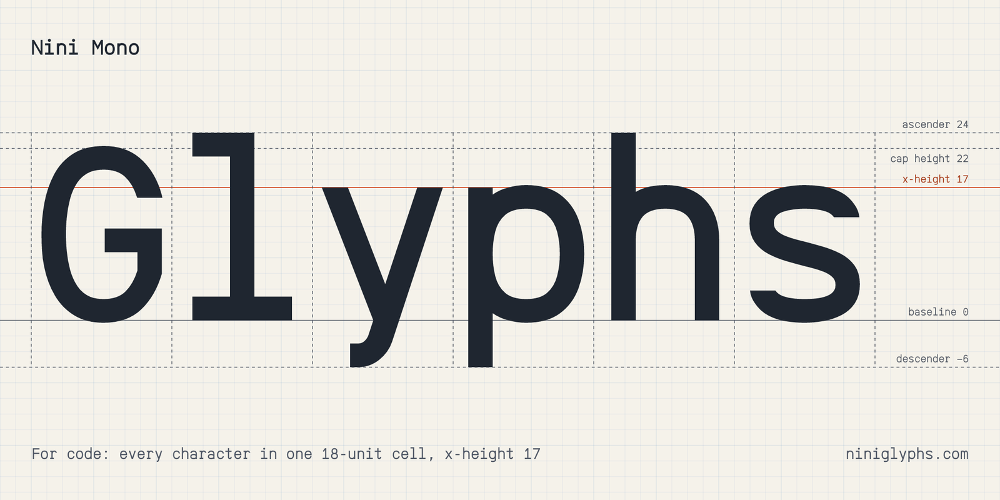
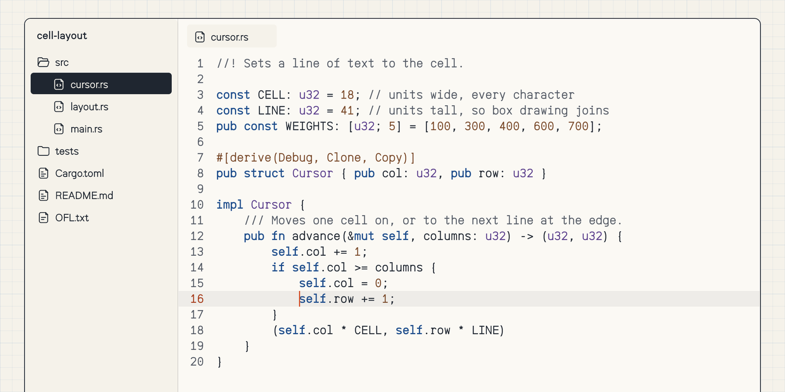
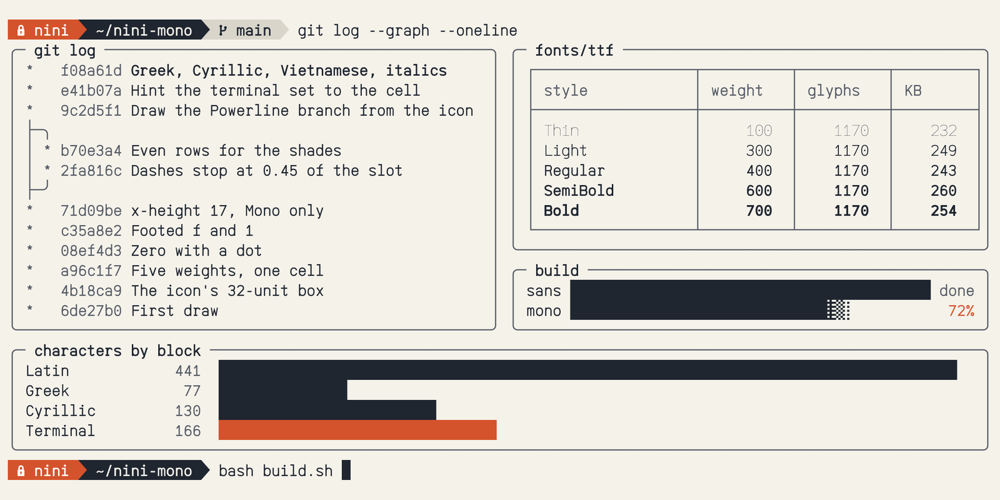
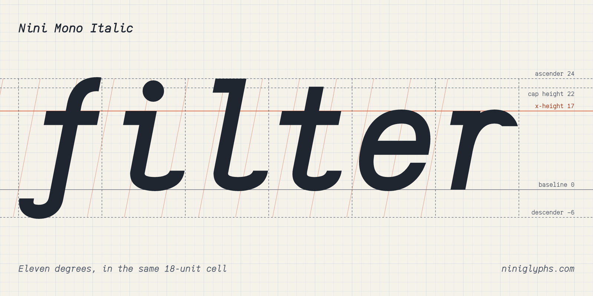

<picture>
  <source media="(prefers-color-scheme: dark)" srcset="documentation/readme/hero-dark.png">
  
</picture>

<p align="center">
  <a href="https://niniglyphs.com/mono/"><b>See it set</b></a> ·
  <a href="https://github.com/niniglyphs/nini-mono/releases/latest">Download</a> ·
  <a href="https://github.com/niniglyphs/nini-sans">Nini Sans</a> ·
  <a href="https://github.com/niniglyphs/ninicons">Ninicons</a>
</p>

# Nini Mono

Nini Mono is the monospaced companion to Nini Sans, drawn with the same Ninicons pen for code, terminals and tables. Five weights (Thin, Light, Regular, SemiBold, Bold), each matched to a Ninicons icon stroke, and an
italic for each at 11 degrees. Its sibling is [Nini Sans](https://github.com/niniglyphs/nini-sans).

Letters move part of the way towards an even width, as monospaced faces' do, while the pen keeps its width, so narrow letters open and wide ones close up without losing weight; where more than two strokes cross a cell (m, w, M, W) the pen thins. i, j, l and r take serifs and slabs, the zero carries a dot so it never reads as O, and % and @ are drawn to the cell.

## In an editor

<picture>
  <source media="(prefers-color-scheme: dark)" srcset="documentation/readme/editor-dark.png">
  
</picture>

## In a terminal

<picture>
  <source media="(prefers-color-scheme: dark)" srcset="documentation/readme/terminal-dark.png">
  
</picture>

## Italics

<picture>
  <source media="(prefers-color-scheme: dark)" srcset="documentation/readme/italic-dark.png">
  
</picture>

The italics lean 11 degrees and are slanted through the pen, so strokes keep their weight. A few letters are drawn
again rather than slanted; Cyrillic takes its written italic forms.

## Character set and features

- Latin: Google Fonts Latin Core (Latin-1, Latin Extended-A, Romanian Ș ș Ț ț, Welsh Ẁ Ẃ Ẅ Ỳ, the capital sharp s ẞ)
  and Vietnamese, with common punctuation, currency, maths and arrow symbols.
- Greek, monotonic and polytonic (U+1F00–1FFE), and Cyrillic.
- Combining marks with `mark`/`mkmk` positioning; capitals take flatter capital marks and i, j and į lose their dots
  under a mark above (`ccmp`).
- Box drawing (U+2500–257F), block elements (U+2580–259F) and Powerline symbols (U+E0A0, E0A2, E0B0–E0B3), drawn to the cell so they join.
- Statically hinted TrueType (ttfautohint), plus WOFF2 for the web.

## Building

The fonts build from the UFO sources in `sources/` with [gftools builder](https://github.com/googlefonts/gftools)
(fontmake), in one step:

```bash
python -m venv venv
. venv/bin/activate          # Windows: venv\Scripts\activate
pip install -r requirements.txt
cd sources && gftools builder config.yaml
```

This writes `fonts/ttf/` and `fonts/webfonts/`. Check them as Google Fonts does, with
[fontspector](https://github.com/fonttools/fontspector):

```bash
fontspector --profile googlefonts -x googlefonts/repo/dirname_matches_nameid_1 fonts/ttf/*.ttf
```

## About the sources

The sources are UFO 3 files, one per style (five weights, roman and italic), and open in any font editor.

## License

Copyright 2026 The Nini Mono Project Authors — Sayantan Roy (https://github.com/niniglyphs/nini-mono).

This Font Software is licensed under the SIL Open Font License, Version 1.1 ([OFL.txt](OFL.txt)), also available with a
FAQ at https://openfontlicense.org.

## Repository layout

```
├── OFL.txt, AUTHORS.txt, CONTRIBUTORS.txt, README.md, requirements.txt
├── documentation/          specimen images; readme/ holds this page's; article/ is the Google Fonts "About" page
├── sources/                NiniMono-*.ufo and config.yaml (gftools builder)
└── fonts/ttf, fonts/webfonts
```

Source: https://github.com/niniglyphs/nini-mono
