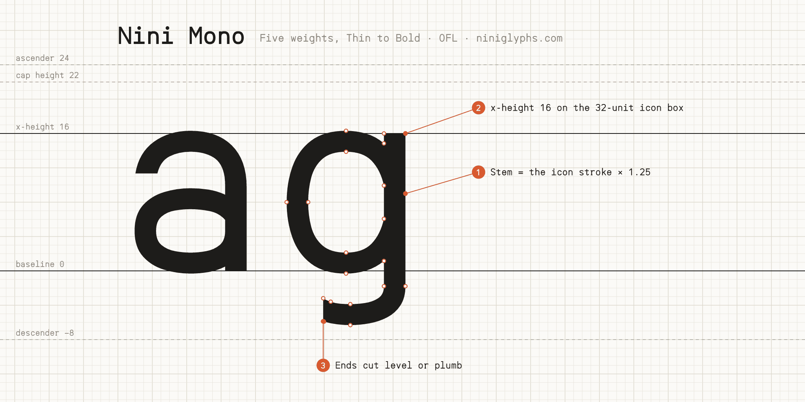

# Nini Mono



Nini Mono is the monospaced companion to Nini Sans, drawn with the same Ninicons pen for code, terminals and tables. Five weights (Thin, Light, Regular, SemiBold, Bold), each matched to a Ninicons icon stroke.
Its sibling is [Nini Sans](https://github.com/niniglyphs/nini-sans).

Letters move part of the way towards an even width, as monospaced faces' do, while the pen keeps its width, so narrow letters open and wide ones close up without losing weight; where more than two strokes cross a cell (m, w, M, W) the pen thins. i, j, l and r take serifs and slabs, the zero carries a dot so it never reads as O, and % and @ are drawn to the cell.

## Character set and features

- Google Fonts Latin Core: Latin-1, Latin Extended-A, Romanian (Ș ș Ț ț), Welsh (Ẁ Ẃ Ẅ Ỳ), the capital sharp s (ẞ), and
  common punctuation, currency, maths and arrow symbols.
- Combining marks (U+0300–U+030C, U+0326–U+0328, U+0331) with `mark`/`mkmk` positioning; capitals take flatter capital marks
  and i, j and į lose their dots under a mark above (`ccmp`).
- Box drawing (U+2500–257F), block elements (U+2580–259F) and Powerline symbols (U+E0A0, E0A2, E0B0–E0B3), drawn to the cell so they join.
- Statically hinted TrueType (ttfautohint), plus WOFF2 for the web.

## Building

The fonts build from the UFO sources in `sources/` with [gftools builder](https://github.com/googlefonts/gftools)
(fontmake), in one step:

```bash
python -m venv venv
. venv/bin/activate          # Windows: venv\Scripts\activate
pip install -r requirements.txt
cd sources && gftools builder config.yaml
```

This writes `fonts/ttf/` and `fonts/webfonts/`. Check them as Google Fonts does, with
[fontspector](https://github.com/fonttools/fontspector):

```bash
fontspector --profile googlefonts -x googlefonts/repo/dirname_matches_nameid_1 fonts/ttf/*.ttf
```

## About the sources

The sources are UFO 3 files, one per weight, and open in any font editor.

## License

Copyright 2026 The Nini Mono Project Authors — Sayantan Roy (https://github.com/niniglyphs/nini-mono).

This Font Software is licensed under the SIL Open Font License, Version 1.1 ([OFL.txt](OFL.txt)), also available with a
FAQ at https://openfontlicense.org.

## Repository layout

```
├── OFL.txt, AUTHORS.txt, CONTRIBUTORS.txt, README.md, requirements.txt
├── documentation/          specimen images; article/ is the Google Fonts "About" page
├── sources/                NiniMono-*.ufo and config.yaml (gftools builder)
└── fonts/ttf, fonts/webfonts
```

Source: https://github.com/niniglyphs/nini-mono
